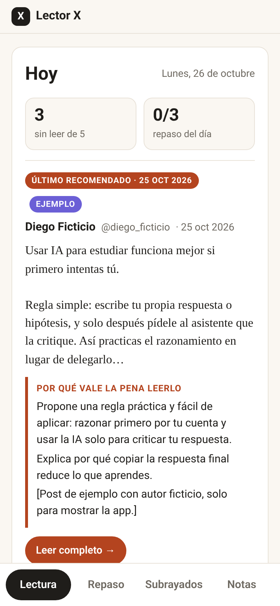
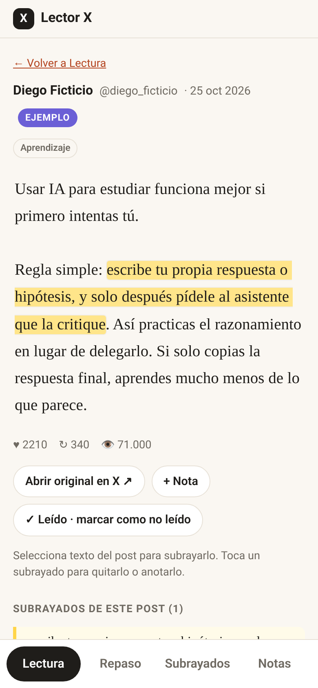
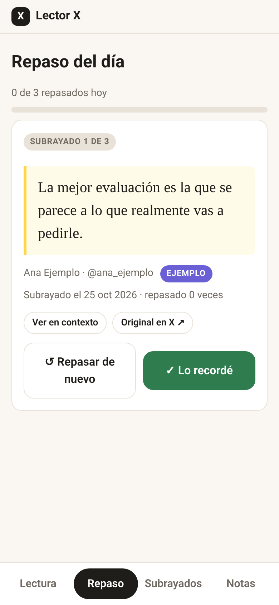

# Lector X

Lectura diaria de los posts más virales de X sobre un tema (por defecto **IA**), con **subrayados, notas y repaso diario**.
App local: Python 3 (solo librería estándar) + HTML/JS/CSS estático. **Sin base de datos y sin dependencias.** Interfaz en español, pensada primero para móvil.

| Hoy | Post con subrayados | Repaso |
|---|---|---|
|  |  |  |

Más capturas (móvil y escritorio) en [`docs/screenshots/`](docs/screenshots/). Todas usan los datos de ejemplo, con autores ficticios.

## Funciones
- **Hoy**: el recomendado del día con su "por qué", posts sin leer y progreso del repaso.
- **Lectura**: biblioteca con búsqueda de texto (sin tildes ni mayúsculas), chips de tema y filtro Todos / Sin leer / Leídos. Un post se marca leído al abrirlo o con el botón.
- **Subrayar**: selecciona texto de un post y se guarda con offsets; se vuelve a pintar al abrir el post y se puede quitar.
- **Subrayados**: todo lo subrayado en un lugar, agrupado por fecha, con el post de origen y botón para ir a él.
- **Notas con contexto**: fecha, post de origen, subrayado asociado (opcional) y "por qué lo anoté"; editar y borrar.
- **Repaso diario**: 3 subrayados al día. Selección determinista por fecha: primero los menos repasados (los marcados "Repasar de nuevo" van antes a igualdad) y rotación estable por `sha1(fecha|id)`. Botones **Lo recordé** / **Repasar de nuevo**.

## Estructura
```
server.py       servidor HTTP (0.0.0.0, puerto de config.json, 8787 por defecto) + API JSON
static/         index.html, app.js, style.css
ingest.py       normaliza JSON crudos de X -> data/posts/<id>.json y data/digest/YYYY-MM-DD.json
fetch_top.py    imprime los argumentos de búsqueda en X (solo lectura) según config.json
start.sh        arranca/reinicia el servidor en segundo plano (logs/)
config.json     tema, hora (08:00), idioma (es), puerto, query y filtros
data-sample/    datos de EJEMPLO (5 posts ficticios + subrayados, notas, repaso y leídos)
data/           tus datos (vacío al clonar; está en .gitignore)
```

## Cómo arrancar
Requisitos: `python3` (3.9 o superior) y `curl` (solo para el chequeo de `start.sh`).

```bash
git clone <URL-del-repo> lector-x && cd lector-x
chmod +x start.sh
./start.sh data-sample              # prueba con datos de ejemplo -> http://localhost:8787
```
Otro puerto: `PORT=8899 ./start.sh data-sample`. Con tus datos: `./start.sh` (usa `./data`).
Sin `start.sh`: `LECTORX_DATA=data-sample PORT=8787 python3 server.py`.
Para detenerlo: `kill $(cat logs/server-<puerto>.pid)`.

### Usar `data-sample/` como datos iniciales
`data-sample/` es una carpeta de datos completa (posts, digest, highlights.json, notes.json, read.json, review.json).
- Para **explorar**: `./start.sh data-sample` (lo que hagas se guarda ahí; usa una copia si quieres conservarlo intacto).
- Para **empezar desde esos datos**: `cp -r data-sample/. data/` y luego `./start.sh`. Las notas y posts de ejemplo están marcados como tales; bórralos cuando quieras.
- Para **empezar en limpio**: deja `data/` vacío y trae posts con el ciclo diario de abajo.

## Ciclo diario (traer posts reales de X)
Lector X **no se conecta a X por sí mismo**: necesita un JSON en formato de la API v2 de X (`data` + `includes.users`, con `public_metrics`).
Puedes producirlo con cualquier herramienta de **lectura** de X (por ejemplo un agente con acceso de solo lectura a la búsqueda de X) y guardarlo en `raw/`.

1. `python3 fetch_top.py` imprime los argumentos de la búsqueda (`query`, `start_time` de las últimas 48 h, `max_results`, campos) según `config.json`.
2. Ejecuta esa búsqueda con tu herramienta y guarda la respuesta en `raw/search-YYYY-MM-DD-1.json`.
   Nota: algunas herramientas ignoran operadores como `min_likes:`; por eso `ingest.py` también filtra localmente (`config.json -> filter`).
3. Opcional: pide los ~10 mejores posts por id con el campo `note_tweet` (el texto completo de posts largos) y guárdalos en `raw/lookup-YYYY-MM-DD-1.json`.
4. `python3 ingest.py 'raw/*YYYY-MM-DD*.json' --pick <post_id> --why "2-4 líneas de por qué vale la pena leerlo"`
   (sin `--pick/--why` elige el de mayor puntaje y escribe un "por qué" automático con métricas).

Solo lectura: nada de publicar, dar like, seguir ni responder en X. `raw/` y `data/` no se suben a git.

### Configuración (`config.json`)
- `topic`, `time`, `language`, `port`.
- `fetch`: query, ventana en horas, campos pedidos.
- `filter`: mínimos de likes/reposts/caracteres, idiomas, regex de inclusión y exclusión, máximo de posts guardados.
- `tags`: expresiones que asignan temas (chips) a cada post; es una heurística simple, edítala a tu gusto.

## Acceso desde el móvil u otros equipos
El servidor escucha en `0.0.0.0`, así que desde la misma red abre `http://<IP-de-tu-equipo>:8787`. Alternativas:
- **Tailscale (opcional)**: instálalo en el equipo y en el móvil, `sudo tailscale up --hostname=lector-x`, y abre `http://lector-x:8787` o la IP 100.x.x.x de tu tailnet. Es privado y no expone nada a internet.
- **Túnel SSH**: `ssh -L 8787:localhost:8787 usuario@servidor` y abre `http://localhost:8787`.
- **Solo local**: mira el servidor con `localhost` y no abras el puerto en el firewall.

Atención: la app **no tiene autenticación**. No la publiques directamente en internet.

## API
`GET /api/posts` · `GET /api/posts/<id>` · `GET|POST /api/highlights` · `DELETE /api/highlights/<id>` ·
`GET|POST /api/notes` · `PUT|DELETE /api/notes/<id>` · `GET /api/digest/today` · `GET /api/today` (recomendado + sin leer + repaso) ·
`GET /api/review/today` · `POST /api/review {highlight_id, result: remembered|again}` ·
`GET /api/read` · `POST /api/posts/<id>/read {read: true|false}` · `GET /api/health`

Los offsets de subrayado (`start`/`end`) son **unidades UTF-16** sobre el texto del post (igual que JavaScript).
Las escrituras son atómicas (archivo temporal + rename) con un lock simple en el servidor.

## Modelo de datos
- **post**: `id, url, author_name, author_username, text, created_at, metrics{likes,reposts,replies,quotes,bookmarks,impressions}, topic, tags[], fetched_at, recommended, why`
- **highlight**: `id, post_id, text, start, end, created_at`
- **nota**: `id, post_id, highlight_id|null, highlight_text, body, why, created_at, updated_at`
- **digest** (`data/digest/YYYY-MM-DD.json`): `date, topic, post_id, why, generated_at`
- **read.json**: `{post_id: fecha_iso}`
- **review.json**: `{items: {highlight_id: {count, last_reviewed, last_result, history:[{date, at, result}]}}, days: {YYYY-MM-DD: [ids]}}`

## Privacidad
Todo vive en archivos JSON locales. La app no envía datos a ningún servicio.
